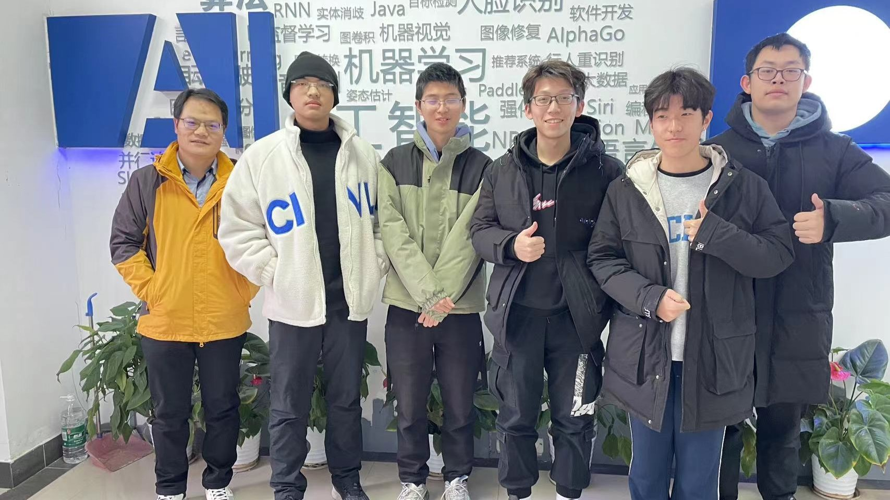
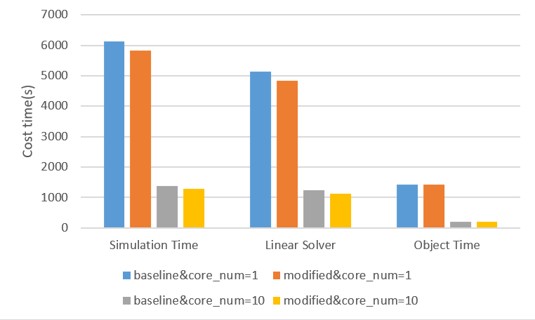

# ASC24 · Wuhan University



**ASC Student Supercomputer Challenge 2024 · Team ASC604 · Second Class Prize**

We are a five-student team from Wuhan University. This repository brings together our preliminary-round report, benchmark records, Llama 2 inference experiments, and OpenCAEPoro solver work.

[Competition report](reports/asc24-preliminary-report.pdf) · [Technical notes](docs/technical-notes.md) · [Award certificate](assets/second-class-prize.jpg)

## Competition work

| Task | Focus | Materials |
| --- | --- | --- |
| HPC system design | CPU/GPU resource allocation within a 3,000 W power budget | [Design notes](docs/system-design.md) |
| HPL & HPCG | Benchmark configuration, process placement, and performance analysis | [Benchmark records](tasks/hpl-hpcg/) |
| LLM inference | Llama 2 model parallelism, KV caching, and Nsight Systems profiling | [Code and experiments](tasks/llm-inference/) |
| OpenCAEPoro | MPI scaling and matrix assembly in the PETSc CPR solver | [Solver and case results](tasks/opencaeporo/) |

Our OpenCAEPoro report records a speedup of more than **4.8×** over the original single-process run, using the modified solver with 10 MPI processes on one node. The submitted case log records **1,274.472 seconds** of simulation time; the linear solver accounts for **88.896%** of that time.



*Figure 6.6 from our report: original and modified code, each with 1 and 10 processes. See the [experiment notes](tasks/opencaeporo/README.md#results) for the recorded configuration and source files.*

## Repository

```text
assets/                 Team photo, certificate, and report figures
docs/                   System design, technical notes, and source inventory
reports/                Preliminary-round report and LLM chapter excerpt
tasks/
  hpl-hpcg/             Benchmark notes and original HPCG logs
  llm-inference/        Llama 2 source snapshot and profiling launcher
  opencaeporo/          PETSc solver, case outputs, and submission archive
```

Start with the [report](reports/asc24-preliminary-report.pdf) for the competition submission, or open a task directory for its code and results. The [source inventory](docs/source-inventory.md) records where the files came from.

These are the materials retained from our 2024 work. The task READMEs describe the dependencies and limits of each snapshot. In particular, the saved HPCG run passed its numerical checks but ran for only 89.658 seconds, below the 1,800-second requirement for an official result. The original cluster environment and model weights are not bundled.

## Team

| Member | Role |
| --- | --- |
| Xianyi Wei | Team captain |
| Xirui Shui | Team member |
| Zhongwei Xie | Team member |
| Han Qiu | Team member |
| Haihang Zou | Team member |

**Supervisors:** Zhigao Zheng, Bo Du, and Zhengguo Hong, as listed in the preliminary-round report.

We thank our supervisors and Wuhan University for their guidance and computing support.

## Acknowledgments

Our work builds on the [ASC24 LLM baseline](https://github.com/ASC-Competition/ASC24-LLM-inference-optimization), [Meta Llama 2](https://github.com/meta-llama/llama/tree/llama_v2), [HPCG](https://github.com/hpcg-benchmark/hpcg), and the [OpenCAEPoro ASC2024 distribution](https://github.com/OpenCAEPlus/OpenCAEPoro_ASC2024). Upstream code retains its original notices and terms; see [third-party notices](THIRD_PARTY_NOTICES.md).
