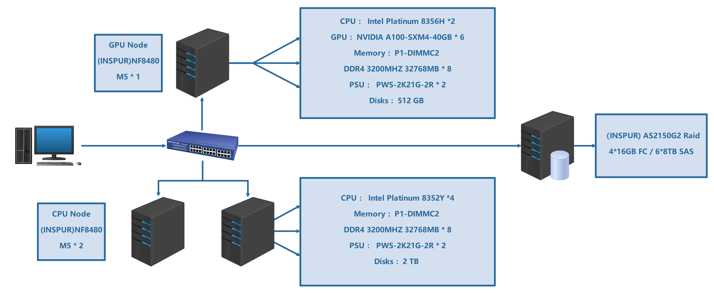

# HPC system design

The preliminary-round proposal describes a system with GPU and CPU nodes, shared storage, and a 3,000 W power budget. Workloads would use either a GPU-dominated or a CPU-dominated configuration.

The diagram is an original planning artifact. It is not an inventory of a verified deployment.

## Proposed operating modes

| Mode | Intended use | Power estimate in the report |
| --- | --- | --- |
| GPU-dominated | Highly parallel computation and model inference | 2,960 W |
| CPU-dominated | CPU-intensive numerical work | 2,930 W |

The report describes six NVIDIA A100-SXM4-40GB GPUs, Intel Xeon Platinum CPUs, and three Inspur NF8480M5 servers. Power estimates are design calculations, not wall-meter measurements.

## Reading the hardware records

The design, benchmark descriptions, and inference experiments refer to different configurations. The design lists six GPUs, while the LLM ablation figure describes eight-GPU experiments. The diagram labels the GPU-node CPU as 8356H; the report's hardware table lists 8352Y. These records should not be treated as a single reproducible machine specification.

For a new run, record the actual node allocation, CPU model, GPU count, memory, interconnect, driver, CUDA version, compiler, MPI implementation, and power settings alongside the result.

Source: [preliminary-round report](../reports/asc24-preliminary-report.pdf), Chapter 3, printed pages 9–13.
