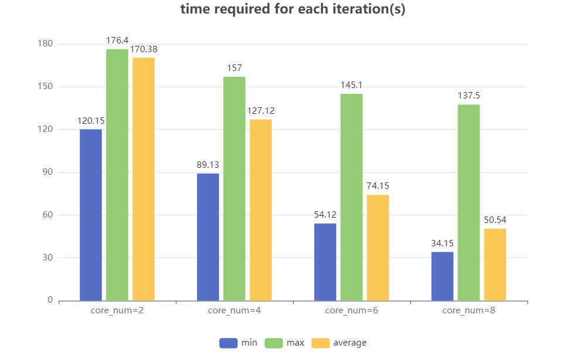
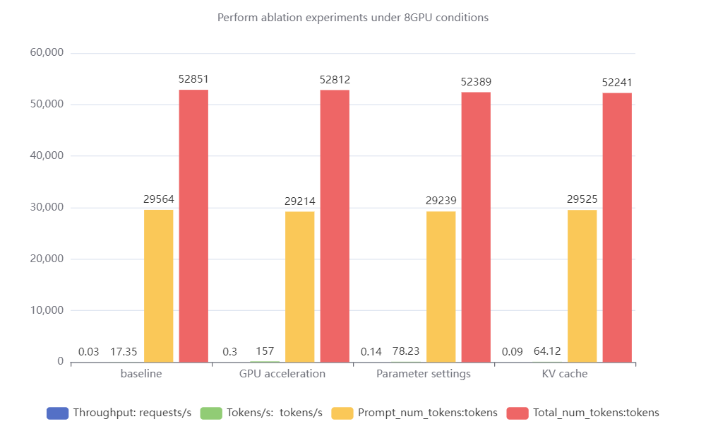

# Llama 2 inference

This directory preserves the Llama 2 code from the team's working files. The four package modules have been placed under `llama/` to match their existing imports. Their contents and the text-completion example are unchanged.

## Files

| Path | Purpose |
| --- | --- |
| `llama/model.py` | Transformer, model-parallel layers, and attention KV caches |
| `llama/generation.py` | Checkpoint loading, generation, and NVTX profiling ranges |
| `llama/tokenizer.py` | SentencePiece tokenizer wrapper |
| `example_text_completion.py` | Four-prompt text-completion example |
| `config/params.json` | Saved 70B model configuration |
| `profile.slurm` | Profiling job adapted from the team's launcher |

## Experiments

The [LLM chapter](../../reports/llm-inference-excerpt.pdf) discusses GPU execution, parameter settings, and KV caching. The figures below were extracted directly from that chapter in the full report.



*Figure 5.1: iteration time for different GPU counts.*



*Figure 5.2: the report's eight-GPU ablation comparison. Throughput, token rate, and token counts have different units; they share an axis in the original figure. The individual variants should not be interpreted as cumulative speedups.*

The figures are historical report evidence. Raw logs for the full ablation set and a pinned software environment are not included.

## Environment and launch

The snapshot imports PyTorch, FairScale, SentencePiece, NumPy, and Python Fire. Profiling uses NVIDIA Nsight Systems. A working environment needs a CUDA-enabled PyTorch build and mutually compatible package versions; no exact dependency lockfile was retained.

The launcher requests one Slurm node with eight GPUs and eight CPU cores per task. Its account, partition, and module names come from the original cluster and need to match your site. Submit it from this directory after preparing `log/` and the checkpoint link:

```bash
mkdir -p log checkpoints
ln -s /data1/sieniwgroup/sieniw/models/meta-llama/Llama-2-70b checkpoints/llama-2-70b
sbatch profile.slurm
```

This assumes the licensed checkpoint already exists at that location. The loader expects Meta-format `*.pth` shards and a matching `params.json`; the tokenizer path must point to its `tokenizer.model`. The shard count must equal the model-parallel world size. Hugging Face `safetensors` files cannot be loaded by this code as-is.

The launcher retains `torch.distributed.launch`, which passes a local rank to the original Fire entry point. Its module versions reflect the old cluster. It has not been validated against a current PyTorch installation.

Profiling traces are written to `/data1/sieniwgroup/sieniw/projects/asc24/nsys-reports/` so large output files stay outside the Git checkout. Adjust this location if your cluster uses a different storage layout.

The example generates completions for four prompts. For the competition workload and evaluation protocol, consult the [ASC24 baseline repository](https://github.com/ASC-Competition/ASC24-LLM-inference-optimization).

## Source and terms

The implementation derives from Meta's Llama 2 code and retains its copyright headers. See [LICENSE](LICENSE), [USE_POLICY.md](USE_POLICY.md), and [NOTICE](NOTICE). Model weights and tokenizer files are not distributed here.
